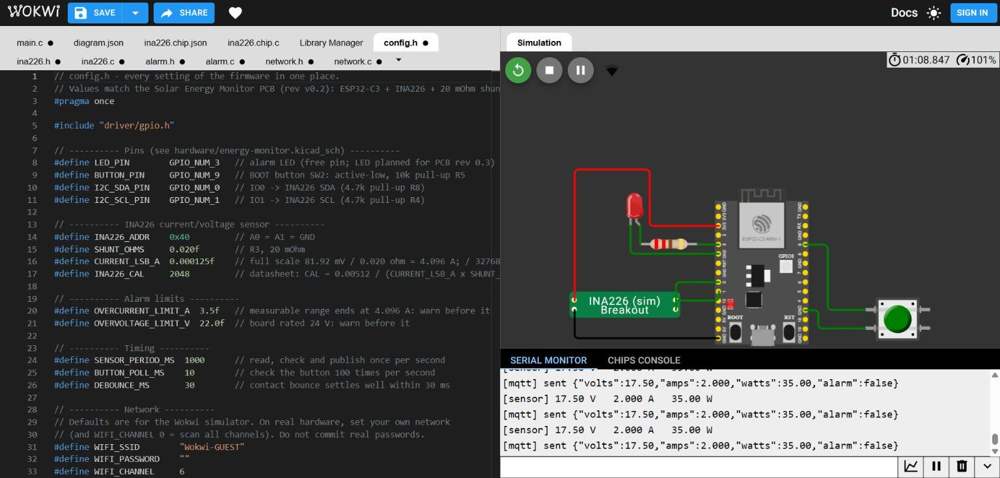

# Firmware: ESP32-C3 Solar Energy Monitor

C firmware (ESP-IDF, FreeRTOS) for the board in this repository. It reads the panel's voltage, current and power from the INA226, raises a latched alarm on faults, and publishes the readings over Wi-Fi with MQTT.

> **Status:** tested in the [Wokwi](https://wokwi.com) simulator with a simulated INA226 (`sim/ina226.chip.c`, written from the datasheet register map). **Not yet run on the real board.**



## Features

- **Measurement:** reads bus voltage, current and power from the INA226 over I²C once per second (IO0 = SDA, IO1 = SCL, 100 kHz, address 0x40).
- **Calibration:** 20 mΩ shunt, 81.92 mV full scale → 4.096 A → current LSB = 4.096 A / 32768 = **125 µA**. CAL = 0.00512 / (125 µA × 0.020 Ω) = **2048**. Power LSB = 25 × current LSB = 3.125 mW.
- **Latched alarm:** overcurrent (> 3.5 A), overvoltage (> 22 V) or sensor not responding turns the alarm LED on. It stays on until the BOOT button (IO9, debounced) resets it, and trips again within 1 s if the fault is still present.
- **Sensor recovery:** a power-cycled INA226 forgets its calibration and would report 0 A. The driver notices the failed reads and writes the calibration again when the sensor answers.
- **Telemetry:** JSON over MQTT once per second, for example `{"volts":17.50,"amps":2.000,"watts":35.00,"alarm":false}`. Wi-Fi and MQTT reconnect automatically.
- **Two FreeRTOS tasks:** `button_task` (polls every 10 ms) and `sensor_task` (1 s period).

## Code structure

| File | Responsibility |
|---|---|
| `main/main.c` | Start-up and the two tasks (button, sensor) |
| `main/config.h` | All settings: pins, INA226 calibration, alarm limits, timing, network |
| `main/ina226.c/.h` | INA226 driver: I²C set-up, ID check, calibration, readings in V/A/W |
| `main/alarm.c/.h` | Latched alarm and LED: trip, reset, status |
| `main/network.c/.h` | Wi-Fi station and MQTT client, publish |
| `sim/` | Wokwi wiring (`diagram.json`) and the simulated INA226 custom chip |

Pins follow the schematic (`../hardware/energy-monitor.kicad_sch`). The alarm LED on GPIO3 is not on PCB rev v0.2; a status LED is planned for rev 0.3.

## Test results (Wokwi simulation, 19 Oct 2026)

| # | Test | Expected | Result |
|---|---|---|---|
| 1 | Normal run, 17.5 V / 2 A | 17.50 V, 2.000 A, 35.00 W printed and published; LED off | Pass |
| 2 | Current raised to 3.8 A | `[ALARM] overcurrent`, LED on | Pass |
| 3 | Current back to 2 A | Alarm stays latched, LED on | Pass |
| 4 | BOOT button pressed | Alarm reset, LED off | Pass |
| 5 | Voltage raised to 23 V | `[ALARM] overvoltage`, LED on | Pass |
| 6 | Button pressed while still at 23 V | Reset, then alarm returns within 1 s | Pass |
| 7 | SDA wire removed | `NOT FOUND!` at start, `sensor not responding` alarm every second | Pass |
| 8 | SDA wire reconnected | Normal readings, no alarm | Pass |
| 9 | Wi-Fi + MQTT | Messages arrive at the broker every second; `"alarm":true` during an alarm | Pass |

## Build for the real board

Requires ESP-IDF 5.2 or newer (uses the `i2c_master` driver).

```bash
cd firmware
idf.py set-target esp32c3
idf.py build flash monitor
```

Before flashing, set your own Wi-Fi network in `main/config.h` (`WIFI_SSID`, `WIFI_PASSWORD`, `WIFI_CHANNEL 0`). Do not commit real passwords. The project has been built with Wokwi's ESP-IDF build service; it has not yet been built with a local `idf.py` installation.

## Run it in the simulator

1. At wokwi.com, start a new **ESP-IDF ESP32-C3** project.
2. Add every file from `main/` (except `CMakeLists.txt`), and replace `diagram.json` with `sim/diagram.json`.
3. Add a custom chip named `ina226` and paste `sim/ina226.chip.json` and `sim/ina226.chip.c`.
4. Press Play. Click the INA226 chip to move the voltage and current sliders.

To watch the MQTT messages, subscribe to `basel-energy-monitor/readings` on `broker.hivemq.com` (for example with the HiveMQ web client). This is a public test broker: never send private data to it.

## License

Firmware: MIT ([LICENSE](LICENSE)). Hardware: CERN-OHL-P-2.0 (see the repository root).
